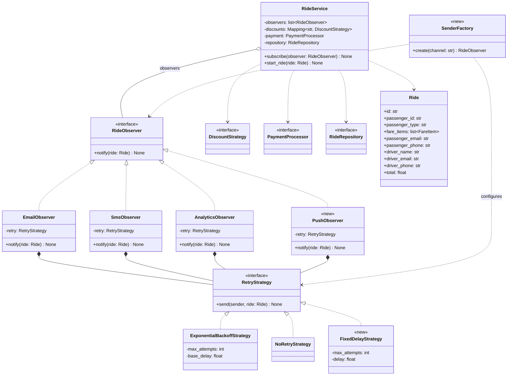

# Лабораторна робота №2. Патерни GoF: Observer, Strategy, Factory Method

**Варіант 2.** Сервіс райдшерингу `RideService`. Мова: Python 3.11, лише стандартна бібліотека (сторонніх залежностей немає).

Під час старту поїздки пасажир отримує підтвердження каналами Email і SMS (а після Завдання 4 ще й Push), а аналітична команда отримує запис у журналі. Код продовжує [лабораторну №1](../lab_1): з неї взято відрефакторені знижки, оплату і репозиторій. Одиночний `Notifier` з першої лаби замінено на Observer. Зовнішні системи замінені на `print`.

Запуск:

```bash
python3.11 -m venv .venv
source .venv/bin/activate
python main.py
```

## Структура

```
lab_2/
├── legacy/order_service.py          # вихідний код з умови (без змін)
├── ride_service/
│   ├── models.py                    # Ride, FareItem
│   ├── ride_service.py              # RideService: Subject
│   ├── observers/
│   │   ├── base.py                  # RideObserver (у тексті умови OrderObserver)
│   │   ├── email.py                 # EmailObserver
│   │   ├── sms.py                   # SmsObserver
│   │   ├── analytics.py             # AnalyticsObserver
│   │   └── push.py                  # Завдання 4
│   ├── retry/
│   │   ├── base.py                  # RetryStrategy
│   │   ├── exponential_backoff.py   # ExponentialBackoffStrategy
│   │   ├── no_retry.py              # NoRetryStrategy
│   │   └── fixed_delay.py           # Завдання 4
│   ├── sender_factory.py            # Завдання 4: SenderFactory
│   ├── discounts/                   # з лабораторної №1
│   ├── payments/                    # з лабораторної №1
│   └── repositories/                # з лабораторної №1
├── main.py
└── README.md
```

На початку кожного `.py`-файлу (крім legacy) є коментар із номером завдання (або «З лабораторної №1») і тим, за що файл відповідає.

## Завдання 1. Аналіз та Code Review

Аналізується [`legacy/order_service.py`](legacy/order_service.py) (код з умови). Для `RideService` з варіанту 2 структура проблеми та сама.

| Принцип | Рядки | Порушення |
|---|---|---|
| **SRP** (Single Responsibility) | 2–13 | `place_order` відповідає водночас за оформлення замовлення (3), вибір каналів (6, 8), формування і надсилання Email та SMS (7, 9) і журнал аналітики (11). Отже, причин для змін у методу кілька: новий текст повідомлення, новий канал, новий формат аналітики. |
| **OCP** (Open/Closed) | 6–9, 11 | Кожен канал вшитий окремим `if`. Щоб додати Push чи Telegram, треба редагувати сам `place_order`. Аналітику теж «додали патчем прямо тут» (10–11), тобто через модифікацію, а не через розширення. |

Додаткові проблеми:
- **Рядок 13:** помилка надсилання ігнорується мовчки, а логіки повторів немає.
- **Рядки 7, 9:** якщо додати повтори прямо в метод, з'являться ще дві гілки з різною поведінкою: Email можна повторювати, SMS ні, бо кожна спроба платна. Метод став би ще більшим.

### Обрані патерни

1. **Observer** для каналів сповіщень. Задача виглядає як «одна подія (старт поїздки) і довільна кількість незалежних реакцій на неї». Сервіс стає Subject і викликає `notify(ride)` для кожного підписника, не знаючи, скільки їх і які вони. Новий канал додається новим класом і підпискою, тож OCP дотримано. Кожен канал є окремим класом, тож SRP дотримано.
2. **Strategy** для логіки повторів. Спосіб повтору є алгоритмом, який має бути різним для різних каналів і замінним без зміни самого каналу. Стратегія інкапсулює алгоритм і передається observer'у через конструктор.

Чому не інші патерни:
- **Chain of Responsibility** зупиняється на першому обробнику, який обробив запит, а нам потрібні **всі** канали одночасно.
- **Decorator** додає поведінку одному об'єкту. Для повторів він міг би підійти, але тоді політика повтору була б «обгорткою» над каналом, а не його конфігурацією. Набирати канал з обгорток складніше, і умова прямо вимагає `RetryStrategy` у конструкторі.
- **Template Method** вшив би алгоритм повторів у базовий клас через наслідування. Змінити його для конкретного каналу без нового підкласу було б неможливо, а Strategy дозволяє комбінувати будь-який канал з будь-якою стратегією.
- **Mediator** потрібен для взаємодії багатьох об'єктів між собою. Тут взаємодія односпрямована: від сервісу до каналів.

## Завдання 2. Observer

- [`RideService`](ride_service/ride_service.py) є Subject. Він зберігає список `_observers` і має метод `subscribe(observer)`. У `start_ride` після оплати і збереження він викликає `observer.notify(ride)` для кожного підписника. У сервісі немає `if` за каналами і немає `isinstance`.
- [`RideObserver`](ride_service/observers/base.py) — спільний інтерфейс з одним методом `notify(ride)`.
- Реалізації: `EmailObserver`, `SmsObserver` і `AnalyticsObserver`. Останній замінює рядок `[ANALYTICS]`, який у legacy-коді було «додано патчем».
- Підписка відбувається один раз під час налаштування застосунку в `main.py`, а не всередині `start_ride`.

Набір каналів визначає підписка. Прапорці `wants_email` і `wants_sms` з legacy-коду прибрано: який канал підписаний, той і отримує подію. Наслідок: канали спільні для всіх пасажирів, а не налаштовуються кожним окремо.

## Завдання 3. Strategy

- [`RetryStrategy`](ride_service/retry/base.py) має метод `send(sender, ride)`, де `sender` — функція, яка фактично надсилає повідомлення. Стратегія вирішує, скільки разів її викликати при `ConnectionError`.
- Реалізації:
  - `ExponentialBackoffStrategy`: до 3 спроб з паузою 0.1 → 0.2 → 0.4 с. Використовується для Email, бо лист може почекати.
  - `NoRetryStrategy`: одна спроба. Використовується для SMS, бо кожна спроба коштує грошей.
- Observer'и отримують стратегію через конструктор і надсилають **через неї**: `self._retry.send(self._send, ride)`. Сам observer лише формує повідомлення в `_send`.
- Якщо всі спроби невдалі, стратегія пише про це в лог і не кидає виняток. Помилка не мовчазна, як у legacy-коді, і при цьому не зупиняє сповіщення інших підписників.
- `AnalyticsObserver` теж отримує стратегію. У проді журнал аналітики — це зовнішній сервіс, і запис у нього може не вдатися.

## Завдання 4. Розширення без зміни існуючого коду

| Вимога | Новий файл |
|---|---|
| Канал `PushObserver` | [`observers/push.py`](ride_service/observers/push.py) |
| Стратегія `FixedDelayStrategy` (фіксована пауза, до 3 спроб) | [`retry/fixed_delay.py`](ride_service/retry/fixed_delay.py) |
| `SenderFactory` (Factory Method) | [`sender_factory.py`](ride_service/sender_factory.py) |

`SenderFactory.create(channel)` за ідентифікатором `"email"`, `"sms"` або `"push"` повертає готовий observer з правильною стратегією: Email з експоненційною паузою, SMS без повторів, Push з фіксованою паузою. Вибір зроблено через словник, а не через ланцюжок `if`. Невідомий канал дає `ValueError`.

Підключення в `main.py`:

```python
factory = SenderFactory()
service = make_service()
for channel in ("email", "push"):
    service.subscribe(factory.create(channel))
service.subscribe(AnalyticsObserver(ExponentialBackoffStrategy()))
service.start_ride(make_ride("R-2"))
```

```
Processing credit card payment for 160.0
Saving ride R-2 to MySQL Database...
Sending EMAIL to passenger@example.com: ride R-2 started. The driver is: Тарас, +380674445566
Sending PUSH to passenger P-42: ride R-2 started. The driver is: Тарас, +380674445566
[ANALYTICS] ride R-2 started, total=160.0
```

### Чому не довелося правити жоден файл із Завдань 2–3

- **`RideService` залежить лише від абстракції `RideObserver`.** Він просто проходить списком підписників і викликає `notify`. Push для нього такий самий підписник, як і Email, тому сервіс про новий канал нічого не знає.
- **Observer'и залежать лише від абстракції `RetryStrategy`.** Будь-яка нова стратегія, зокрема `FixedDelayStrategy`, підходить до будь-якого observer'а без його змін.
- **`PushObserver` і `FixedDelayStrategy` — нові класи**, що реалізують наявні інтерфейси, тобто розширення, а не модифікація.
- **`SenderFactory` — новий модуль.** Він лише збирає наявні класи в готові комбінації. Знання про те, «який канал з якою стратегією», зосереджене в ньому, а не розкидане по `main` чи сервісу.
- **Змінився лише `main.py`.** Це клієнтський код, і умова прямо вимагає показати підключення саме в ньому.

У `main.py` також показано, як поводяться стратегії при збої мережі. Їм передається функція надсилання, яка перші два рази падає з `ConnectionError`:

```
ExponentialBackoffStrategy:
  attempt 1/3 failed: network is unreachable
  attempt 2/3 failed: network is unreachable
  sent for ride R-3 on call #3
NoRetryStrategy:
  failed, no retry for ride R-3: network is unreachable
FixedDelayStrategy:
  attempt 1/3 failed: network is unreachable
  attempt 2/3 failed: network is unreachable
  sent for ride R-3 on call #3
```

## Завдання 5. UML-діаграма класів

Позначення:
- `<|..` — реалізація інтерфейсу;
- `o--` — агрегація: Subject зберігає список observer'ів;
- `*--` — композиція: observer володіє своєю стратегією;
- `..>` — залежність.

Компоненти з лабораторної №1 показано лише інтерфейсами.



Класи зі стереотипом `<<new>>` додано в Завданні 4.
